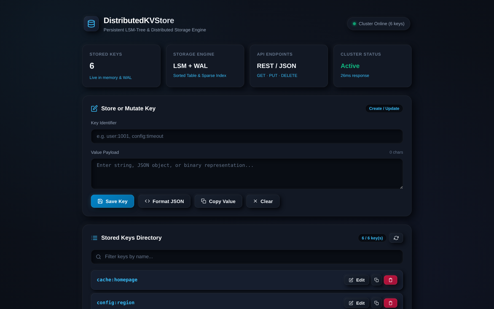
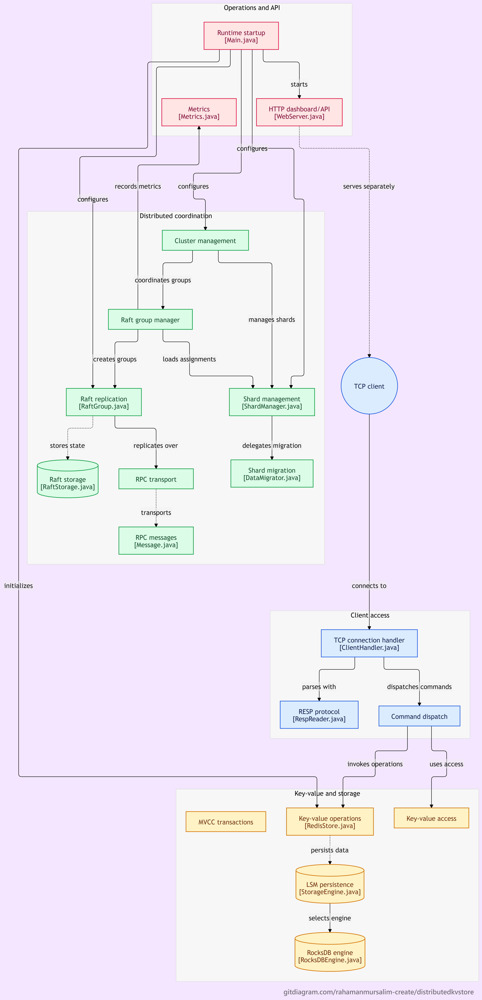
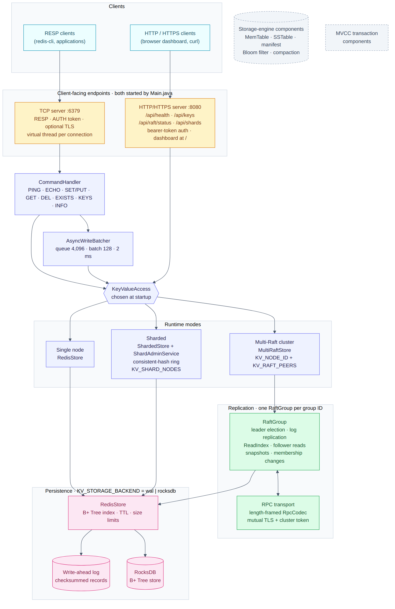
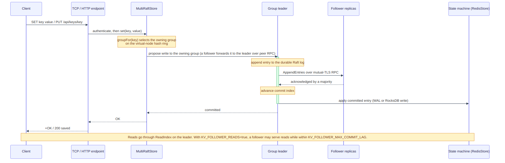
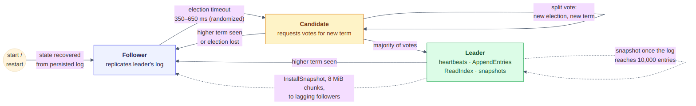
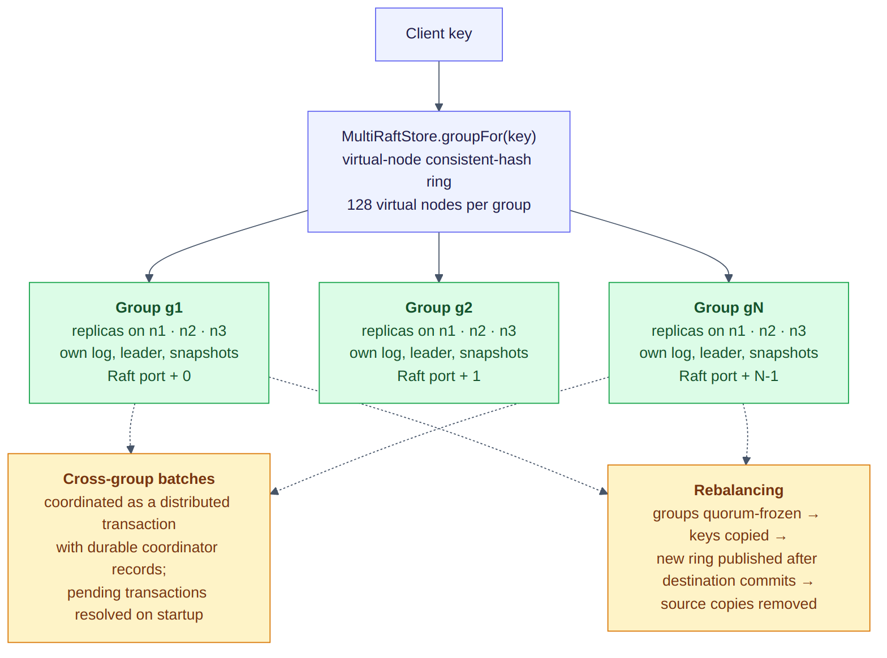
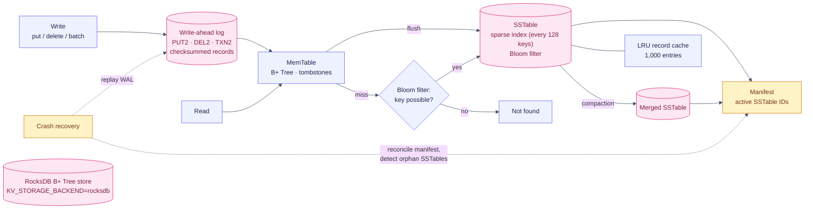
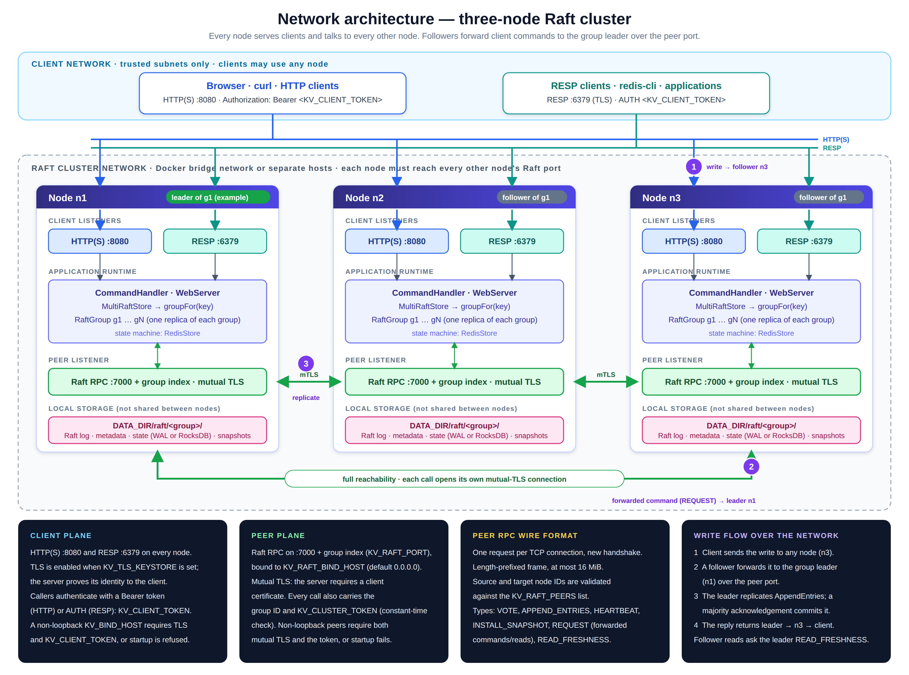

<div align="center">

<h1>Distributed Key-Value Store</h1>

**DistributedKVStore** — Raft/Multi-Raft replication · sharding · persistent storage engine · Redis-style RESP · HTTP dashboard

<br/>


<br/>

[**Live Demo**](https://distributedkvstore.onrender.com/) ·
[**Health Check**](https://distributedkvstore.onrender.com/api/health) ·
[**Source Code**](https://github.com/rahamanmursalim-create/DistributedKVStore)

<br/>

[Overview](#overview) ·
[Features](#features) ·
[Architecture](#architecture) ·
[Network Architecture](#network-architecture) ·
[Quick Start](#quick-start) ·
[API](#api-reference) ·
[Configuration](#configuration-reference) ·
[Testing](#testing-and-validation) ·
[Layout](#project-layout)

</div>

---

## Table of Contents

| # | Section | What you will find |
|---|---------|--------------------|
| 1 | [Overview](#overview) | What the project is and what it explores |
| 2 | [Features](#features) | Capabilities across consensus, storage, networking and security |
| 3 | [Architecture](#architecture) | System design, request lifecycle, Raft, sharding and storage engine |
| 4 | [Network Architecture](#network-architecture) | Cluster topology, ports, protocols and security planes |
| 5 | [Quick Start](#quick-start) | Build, run a node, talk to it over HTTP and RESP |
| 6 | [API Reference](#api-reference) | HTTP/HTTPS endpoints and RESP commands |
| 7 | [Configuration Reference](#configuration-reference) | Environment variables and defaults |
| 8 | [Deployment](#deployment) | Docker image and multi-node cluster setup |
| 9 | [Performance and Benchmarks](#performance-and-benchmarks) | Measured single-node results and their limits |
| 10 | [Independent Development](#independent-development) | Scope of design and implementation work |
| 11 | [Technologies](#technologies) | Languages, tools and concepts used |
| 12 | [Testing and Validation](#testing-and-validation) | Reported results, build and test commands |
| 13 | [Current Limitations](#current-limitations) | What still needs separate verification |
| 14 | [Project Layout](#project-layout) | Repository structure |
| 15 | [License](#license) | Terms of use |

---

## Overview

DistributedKVStore is a Java key-value server and distributed-systems learning project. It includes a Redis-style RESP interface, an HTTP/HTTPS API and dashboard, persistent storage backends, Raft/Multi-Raft replication, and two distinct sharding/storage paths.

The Maven project compiles against Java 17 (`maven.compiler.release=17`), and the supplied Dockerfiles build and run on Eclipse Temurin 17. The repository includes tests for persistence, recovery, consensus, snapshot installation, network partitions, and multi-process scenarios.

**Scope note:** local `KV_SHARD_NODES` sharding remains a single-process mode. Distributed sharding is available through provisioned Multi-Raft groups, whose committed ownership manifest routes keys across the cluster.

**Live Demo:** [Open DistributedKVStore Dashboard](https://distributedkvstore.onrender.com/)  
**Health Check:** [View API Health Status](https://distributedkvstore.onrender.com/api/health)  
**Source Code:** [GitHub Repository](https://github.com/rahamanmursalim-create/DistributedKVStore)

<p align="center">
  
  <br/>
  <sub><b>HTTP dashboard</b> served at <code>/</code>.</sub>
</p>

### At a Glance

| | |
|---|---|
| **Language / runtime** | Java 17 (compiler `release` 17), packaged as one shaded executable JAR |
| **Client interfaces** | RESP over TCP (`6379`), HTTP/HTTPS REST + dashboard (`8080`) |
| **Replication** | Raft groups on a dedicated peer port (`7000` + group index), mutual TLS |
| **Persistence** | `wal` (checksummed WAL + in-memory B+ Tree) or `rocksdb`, selected with `KV_STORAGE_BACKEND` |
| **Separate LSM-style engine** | MemTable/SSTable/manifest/Bloom-filter/compaction implementation with its own tests; not the active `RedisStore` backend selected by `Main.java` |
| **Scaling** | Multi-Raft key routing across Raft groups, or a separate local sharding mode across stores in one process |
| **Security** | Bearer-token / `AUTH` client authentication, TLS, mutual TLS between peers |

---

## Features

| Capability | Details |
|---|---|
| **Raft/Multi-Raft Consensus** | Leader election, replication, failover, and snapshot recovery. |
| **Sharding and Rebalancing** | Local sharding rebalances local stores. Multi-Raft coordinates quorum-fenced data migration across pre-provisioned groups through its authenticated cluster admin endpoint. |
| **Runtime storage** | `RedisStore` uses a B+ Tree with a checksummed WAL, or the alternative RocksDB backend selected by `KV_STORAGE_BACKEND`. |
| **Separate LSM-style engine** | `StorageEngine` implements MemTables, SSTables, manifest-based recovery, Bloom filters, sparse indexes, WAL handling, and compaction; it is a separately exercised storage component, not automatically the active runtime backend. |
| **Storage components** | B+ Tree, RocksDB integration, WAL, SSTables, Bloom filters, and compaction. |
| **Transaction Management** | MVCC-related components and transaction conflict handling. |
| **Read/Write Optimizations** | ReadIndex, follower reads, and asynchronous write batching. |
| **Networking and Protocols** | Concurrent TCP client handling, Redis-style RESP commands, and RPC transport. |
| **HTTP/HTTPS API and Security** | Health checks, key-value operations, bearer-token authentication, and TLS support. |
| **Fault-Tolerance Testing** | Tests for persistence, restart recovery, network partitions, snapshot installation, and multi-process failover. |

---

## Architecture



The architecture connects runtime startup and operations, client request handling, key-value storage, Raft replication, RPC transport, cluster coordination, and shard management. The components enabled in a particular run depend on the selected entry point and runtime configuration.

### System Architecture

Every client request enters through one of two listeners started by `Main.java`, passes through the command layer, and reaches a single `KeyValueAccess` implementation that is selected once at startup. That choice decides whether the node behaves as a standalone store, a sharded router, or a member of a Multi-Raft cluster.

<p align="center">
  
</p>

| Runtime mode | Selected by | Behaviour |
|---|---|---|
| **Single node** | default | `RedisStore` serves every key from one WAL- or RocksDB-backed store. |
| **Sharded (single process)** | `KV_SHARD_NODES` | `ShardedStore` routes keys over a consistent-hash ring of local stores managed by this process; it is not a multi-host shard deployment. `KV_SHARD_ADMIN_TOKEN` enables shard add/remove through `/api/shards`. Membership changes persist the new layout after data copy and before routing changes. |
| **Multi-Raft cluster** | `KV_NODE_ID` + `KV_RAFT_PEERS` | `MultiRaftStore` routes each key to one of several independently replicated Raft groups. |

> **Note:** `KV_SHARD_NODES` remains a local-store mode and cannot be combined with Raft. Distributed sharding is provided by Multi-Raft groups (`KV_RAFT_GROUPS`), with quorum-fenced ownership changes through `/api/raft/rebalance`.

### Request Lifecycle

In Multi-Raft mode, a write is acknowledged after the owning Raft group commits it through a majority. Leader reads use ReadIndex; follower reads are opt-in and bounded by the configured commit-lag setting. These guarantees apply to the Raft runtime path, not to standalone or local-sharded mode.

<p align="center">
  
</p>

### Raft Consensus

Each Raft group runs the standard follower / candidate / leader cycle with randomized election timeouts, persists its log and metadata, takes snapshots as the log grows, and installs snapshots in chunks on lagging followers. Membership changes (learner catch-up, joint replacement, leader removal) are covered by dedicated tests.

<p align="center">
  
</p>

### Multi-Raft and Sharding

`MultiRaftStore` hashes each key onto a virtual-node ring (128 virtual nodes per group in the current `Main.java` wiring) to select a Raft group. Each configured group is instantiated on each configured cluster node and uses its own peer port (`KV_RAFT_PORT` + group index). A batch that touches multiple groups follows the implementation's coordinator/participant transaction protocol, with durable transaction records and startup recovery. Group rebalancing uses ownership epochs and coordinated freeze/copy/cutover logic. These are implemented code paths with test coverage; they should not be interpreted as a claim of production certification or physical multi-host validation.

<p align="center">
  
</p>

### Storage Paths

The repository contains more than one storage implementation; they should not be described as a single combined active engine:

1. **Active runtime (`RedisStore`)** — the default `wal` backend appends and syncs records to a checksummed WAL and maintains an in-memory B+ Tree. With `KV_STORAGE_BACKEND=rocksdb`, `RedisStore` instead persists through `RocksDBBPlusTreeStore`/RocksDB.
2. **Separate LSM-style `StorageEngine`** — an independently implemented and tested component with a MemTable, immutable SSTables, sparse indexes, Bloom filters, a manifest, WAL recovery, and compaction. `Main.java` does not select this component as the active `RedisStore` backend.

This separation matters when interpreting the architecture and the tests: the repository contains both paths, but they are not one runtime pipeline.

<p align="center">
  
</p>

---

## Network Architecture

A node exposes two distinct planes. The **client plane** (HTTP/HTTPS on `PORT`, RESP on `TCP_PORT`) uses bearer-token / `AUTH` authentication when `KV_CLIENT_TOKEN` is configured, and server-authenticated TLS when `KV_TLS_KEYSTORE` is set. The **peer plane** (Raft RPC on `KV_RAFT_PORT` plus group index) uses mutual TLS and a shared cluster token for remote peers. Firewall isolation is an operator/deployment responsibility; the application does not configure cloud or host firewall rules.

In Multi-Raft mode, client requests can enter through a node that is not the leader for the owning group; the runtime uses peer RPC forwarding/leader coordination for the relevant operations. Every node therefore needs peer-plane connectivity to the other configured nodes. The exact consistency guarantee depends on the operation and read mode; follower reads are explicitly bounded-staleness reads.

<p align="center">
  
</p>

### Ports and Protocols

| Plane | Port | Protocol | Authentication | Exposure |
|---|---|---|---|---|
| Client | `8080` (`PORT`) | HTTP, or HTTPS when `KV_TLS_KEYSTORE` is set | `Authorization: Bearer <KV_CLIENT_TOKEN>` when token configured | Bind/firewall policy is deployment-controlled |
| Client | `6379` (`TCP_PORT`) | RESP over TCP, or TLS when `KV_TLS_KEYSTORE` is set | `AUTH <KV_CLIENT_TOKEN>` when token configured | Bind/firewall policy is deployment-controlled |
| Peer | `7000` + group index (`KV_RAFT_PORT`) | Length-framed binary RPC | Mutual TLS + `KV_CLUSTER_TOKEN` for remote peers | Restrict to configured peer addresses |

Peer RPC message types: `VOTE_REQUEST` / `VOTE_RESPONSE` (elections), `APPEND_ENTRIES_REQUEST` / `APPEND_ENTRIES_RESPONSE` and `HEARTBEAT` (replication), `INSTALL_SNAPSHOT` (catching up lagging followers), `REQUEST` / `RESPONSE` (forwarded client commands and reads), and `READ_FRESHNESS_REQUEST` / `READ_FRESHNESS_RESPONSE` (bounded follower reads, where the leader confirms its position with a quorum).

**Wire format.** Each call opens a fresh connection and TLS handshake, sends one length-prefixed frame (maximum 16 MiB), and reads one response whose request ID must match. The frame payload is scoped by Raft group ID and carries the cluster token. The receiver validates that the target node ID is its own, that the source node ID appears in `KV_RAFT_PEERS`, and that the group ID matches. Default timeouts are 500 ms to connect and 1,200 ms to read.

### Network Security Model

| Control | Behaviour |
|---|---|
| **Safe by default** | Listeners bind to `127.0.0.1` unless `KV_BIND_HOST` is changed. |
| **Remote client binding** | A non-loopback `KV_BIND_HOST` requires `KV_TLS_KEYSTORE` and `KV_CLIENT_TOKEN`; the process refuses to start otherwise. |
| **Remote Raft peers** | Non-loopback peers require mutual TLS (`KV_TLS_KEYSTORE` / `KV_TLS_TRUSTSTORE`) and `KV_CLUSTER_TOKEN`; startup fails if either is missing. |
| **Peer authentication** | The RPC server requires a client certificate (`needClientAuth`) when TLS is enabled, and every call also carries `KV_CLUSTER_TOKEN`, compared in constant time. |
| **Client-plane TLS** | HTTPS and RESP-over-TLS authenticate the server to the client; callers authenticate with the client token rather than a certificate. |
| **One identity file** | A single `KV_TLS_KEYSTORE` / `KV_TLS_TRUSTSTORE` pair configures TLS for the client listeners and the Raft transport. |
| **Token comparison** | Bearer tokens and `AUTH` values are compared in constant time. |
| **Shard administration** | `/api/shards` has its own token (`KV_SHARD_ADMIN_TOKEN`) and is disabled when unset. |
| **Resource limits** | Key size, value size, live-key count and live-byte count are capped (`KV_MAX_KEY_BYTES`, `KV_MAX_VALUE_BYTES`, `KV_MAX_LIVE_KEYS`, `KV_MAX_LIVE_BYTES`). |

### Reference Container Topology

The Docker-based check (`scripts/run-docker-cluster-check.ps1`) uses this layout:

| Container | Hostname | Host ports → container | Raft peer address |
|---|---|---|---|
| `kvverify-n1` | `kv1` | `18081` → `8080`, `16379` → `6379` | `kv1:7000` |
| `kvverify-n2` | `kv2` | `18082` → `8080`, `16380` → `6379` | `kv2:7000` |
| `kvverify-n3` | `kv3` | `18083` → `8080`, `16381` → `6379` | `kv3:7000` |

All three attach to one Docker bridge network (`kvverify-raftnet`) and share the peer list `n1=kv1:7000,n2=kv2:7000,n3=kv3:7000`. Raft port `7000` is **not** published to the host, so peer traffic stays inside the network. Each node has its own data volume mounted at `/var/data`.

Recommended firewall policy: permit inbound Raft ports only from the other voter addresses, permit client ports only from application subnets, and deny public sources. See [`scripts/PHYSICAL_CLUSTER_VALIDATION.md`](scripts/PHYSICAL_CLUSTER_VALIDATION.md) for the review procedure.

---

## Quick Start

**Prerequisites:** JDK 17 and Apache Maven. The Maven compiler and Docker images target Java 17.

**1. Build the executable JAR**

```powershell
mvn "-Daether.syncContext.named.factory=rwlock-local" -B clean package
```

Maven Surefire runs the integration scenarios as isolated JUnit Jupiter tests. Existing scenario bodies are currently reused through their `main()` methods, while each test class runs in a fresh fork to keep process-based Raft tests isolated. `-DskipTests` skips the suite.

**2. Start a single node** (HTTP on `8080`, RESP on `6379`, data in `./data`)

```powershell
java -jar target/redis-java-clone-1.0.0.jar
```

**3. Use the HTTP API**

```bash
curl http://localhost:8080/api/health
# {"status":"ok","keys":0}

curl -X PUT -d 'hello' http://localhost:8080/api/keys/demo
# {"status":"saved","key":"demo"}

curl http://localhost:8080/api/keys/demo
# {"key":"demo","value":"hello"}
```

**4. Use any RESP client** (for example `redis-cli -p 6379`)

```text
PING                  -> PONG
SET greeting hello    -> OK
GET greeting          -> "hello"
SET session abc EX 60 -> OK   (expires after 60 seconds)
KEYS *                -> greeting, session, ...
DEL greeting          -> (integer) 1
```

Open <http://localhost:8080/> in a browser for the dashboard.

---

## API Reference

### HTTP / HTTPS

| Method | Endpoint | Description | Success response |
|---|---|---|---|
| `GET` | `/api/health` | Liveness and key count | `200` `{"status":"ok","keys":N}` |
| `GET` | `/api/metrics` | Prometheus text: process uptime, local key count, per-group leader/term/commit/ownership | `200` · same bearer auth as other API routes |
| `GET` | `/api/keys` | List all keys | `200` JSON array of key names |
| `GET` | `/api/keys/{key}` | Read one key | `200` `{"key":…,"value":…}` · `404` if missing |
| `PUT` | `/api/keys/{key}` | Create or update; the request body is the value | `200` `{"status":"saved","key":…}` |
| `DELETE` | `/api/keys/{key}` | Delete one key | `200` `{"status":"deleted"}` · `404` if missing |
| `GET` | `/api/raft/status` | Per-group `leader`, `localLeader`, `term`, `commitIndex`, `ownershipEpoch` | `200` · `404` when Raft is not enabled |
| `POST` | `/api/raft/rebalance` | Quorum-fenced Multi-Raft ownership rebalance; body is comma-separated active group IDs, requires `X-Cluster-Admin-Token` and current first-group leader | `200` · `409` during concurrent/non-coordinator requests; a committed target resumes automatically after coordinator election |
| `GET` / `POST` / `DELETE` | `/api/shards`, `/api/shards/{id}` | List, add or remove shard nodes (needs `KV_SHARD_ADMIN_TOKEN`) | `200` / `201` |

When `KV_CLIENT_TOKEN` is set, every endpoint requires `Authorization: Bearer <token>` and returns `401` otherwise. Cluster operations that cannot reach a quorum return `503` with a JSON error body.

### RESP Commands

| Command | Description |
|---|---|
| `AUTH token` | Authenticate the connection (required first when `KV_CLIENT_TOKEN` is set) |
| `PING [message]` · `ECHO message` | Connectivity checks |
| `SET key value [EX seconds \| PX milliseconds]` · `PUT key value` | Write a key, optionally with a TTL |
| `GET key` | Read a key |
| `DEL key…` · `DELETE key…` | Delete keys |
| `EXISTS key…` | Count existing keys |
| `KEYS pattern` | List keys matching a pattern |
| `INFO` · `COMMAND` · `CONFIG` | Server introspection |

---

## Configuration Reference

All settings are environment variables.

| Variable | Default | Purpose |
|---|---|---|
| `PORT` | `8080` | HTTP/HTTPS listener port |
| `TCP_PORT` | `6379` | RESP listener port |
| `DATA_DIR` | `data` | Root directory for all persistent state |
| `KV_BIND_HOST` | `127.0.0.1` | Client listener bind address (non-loopback requires TLS + token) |
| `KV_STORAGE_BACKEND` | `wal` | Active `RedisStore` backend: `wal` or `rocksdb` (does not select the separate `StorageEngine`) |
| `KV_CLIENT_TOKEN` | unset | Bearer token (HTTP) and `AUTH` password (RESP) |
| `KV_TLS_KEYSTORE` · `KV_TLS_PASSWORD` | unset | Enable TLS on client and peer listeners (password required with keystore) |
| `KV_TLS_TRUSTSTORE` · `KV_TLS_STORE_TYPE` | same path as keystore · `PKCS12` | Peer trust material and keystore type; password uses `KV_TLS_PASSWORD` |
| `KV_NODE_ID` | unset | Enables Raft cluster mode; this node's ID |
| `KV_RAFT_PEERS` | required in cluster mode | `id=host:port` list including this node, e.g. `n1=h1:7000,n2=h2:7000,n3=h3:7000` |
| `KV_RAFT_GROUP_ID` · `KV_RAFT_GROUPS` | `default` · unset | Single group ID, or a comma-separated list for Multi-Raft |
| `KV_RAFT_BIND_HOST` · `KV_RAFT_PORT` | `0.0.0.0` · `7000` | Peer listener address and base port (group *i* uses port + *i*) |
| `KV_CLUSTER_TOKEN` | unset | Shared token authenticating Raft peers (required for non-loopback peers) |
| `KV_CLUSTER_ADMIN_TOKEN` | unset | Enables the cluster-wide Multi-Raft rebalance endpoint; keep in a secret manager |
| `KV_FOLLOWER_READS` · `KV_FOLLOWER_MAX_COMMIT_LAG` | `false` · `0` | Allow bounded-staleness reads from followers |
| `KV_RAFT_ELECTION_MIN_MS` · `KV_RAFT_ELECTION_MAX_MS` | `350` · `650` | Randomized election timeout window |
| `KV_RAFT_RPC_CONNECT_TIMEOUT_MS` · `KV_RAFT_RPC_READ_TIMEOUT_MS` | `500` · `1200` | Peer RPC timeouts |
| `KV_RAFT_SNAPSHOT_LOG_ENTRIES` | `10000` | Log length that triggers a snapshot |
| `KV_SHARD_NODES` · `KV_SHARD_VIRTUAL_NODES` | unset · `128` | Local sharded mode: shard IDs and ring density |
| `KV_SHARD_ADMIN_TOKEN` | unset | Enables `/api/shards` administration |
| `KV_MAX_KEY_BYTES` · `KV_MAX_VALUE_BYTES` | `1024` · `1048576` | Per-entry size limits |
| `KV_MAX_LIVE_KEYS` · `KV_MAX_LIVE_BYTES` | `100000` · `67108864` | Store-wide capacity limits |

JVM system properties `redis.write.queue.capacity` (4096), `redis.write.batch.maxSize` (128) and `redis.write.batch.maxDelayMillis` (2) tune the asynchronous write batcher.

---

## Deployment

### Docker

The repository ships a multi-stage `Dockerfile` using Maven/Temurin 17 for the build and a Temurin 17 JRE runtime, with a non-root user and `EXPOSE 8080 6379`. `Dockerfile.verify` packages an already-built JAR and additionally declares `EXPOSE 7000` for Raft peer traffic. Java 17 is consistent across compile and runtime.

```bash
docker build -t distributed-kvstore .
docker run -p 8080:8080 -p 6379:6379 \
  -e KV_BIND_HOST=0.0.0.0 \
  -e KV_CLIENT_TOKEN=<token> \
  -e KV_TLS_KEYSTORE=/run/kv/identity.p12 -e KV_TLS_PASSWORD=<password> \
  -v "$PWD/identity.p12:/run/kv/identity.p12:ro" \
  -v kvdata:/var/data \
  distributed-kvstore
```

`DATA_DIR` defaults to `/var/data` in the image, and `PORT` is honoured for platforms that inject the HTTP port. Because the example binds to a non-loopback address, TLS material and `KV_CLIENT_TOKEN` are required by the startup checks; mount a valid keystore at the configured path. Set `KV_TLS_TRUSTSTORE` as well when the peer trust material differs from the identity keystore.

### Three-Node Raft Cluster

Start one process per host with the same peer list and its own `KV_NODE_ID`. Use a separate data directory and TLS identity per node.

```bash
# node n1 — repeat on n2 and n3 with KV_NODE_ID=n2 / n3
export KV_BIND_HOST=0.0.0.0
export KV_CLIENT_TOKEN=<client-token>
export KV_CLUSTER_TOKEN=<cluster-token>
export KV_TLS_KEYSTORE=/etc/kv/identity.p12 KV_TLS_TRUSTSTORE=/etc/kv/identity.p12 KV_TLS_PASSWORD=<password>
export KV_NODE_ID=n1
export KV_RAFT_PEERS=n1=10.0.0.11:7000,n2=10.0.0.12:7000,n3=10.0.0.13:7000
export DATA_DIR=/var/data
java -jar redis-java-clone-1.0.0.jar
```

Add `KV_RAFT_GROUPS=g1,g2,g3` to run several Raft groups per node (Multi-Raft); ports `7000`–`7002` are then used on every node. Check leadership with `GET /api/raft/status`.

Operational helpers live in [`scripts/`](scripts): `run-docker-cluster-check.ps1` (three-container cluster check), `run-raft-soak.ps1`, `verify-long-soak.ps1`, `verify-live-security.ps1`, `test-deployment-security.ps1`, `test-physical-cluster.ps1` and the physical-cluster procedures in `PHYSICAL_CLUSTER_TEST.md` / `PHYSICAL_CLUSTER_VALIDATION.md`.

---

## Performance and Benchmarks

A local single-node sequential benchmark using 5,000 writes of 128 bytes reported:

- **Throughput:** 555.7 operations/second
- **P95 latency:** 2.769 ms
- **P99 latency:** 3.512 ms

These measurements reflect the tested workload and local environment. They do not represent distributed-cluster throughput or production availability guarantees. Multi-node performance targets will be established after reproducible distributed-load testing.

---

## Independent Development

Independently designed and developed DistributedKVStore end-to-end, taking ownership of system architecture, implementation, testing, and validation.

| Area | Contribution |
|---|---|
| **Distributed Systems** | Implemented and extended Raft/Multi-Raft components for replication, leader election, failover, snapshot installation, and recovery. |
| **Storage Engine** | Developed storage components involving WAL, MemTables, SSTables, B+ Trees, RocksDB integration, and compaction. |
| **Sharding** | Built consistent hashing, shard migration, rebalancing, and ownership coordination. |
| **Networking and Security** | Implemented TCP/RESP request handling, RPC communication, HTTP/HTTPS APIs, authentication, and TLS integration. |
| **Testing and Reliability** | Developed tests and validation scripts for concurrency, persistence, crash recovery, network partitions, and multi-process failover. |

---

## Technologies

| Category | Stack |
|---|---|
| **Language** | Java |
| **Build Tool** | Apache Maven |
| **Distributed Systems** | Raft, Multi-Raft, replication, consensus, and sharding |
| **Storage Technologies** | RocksDB, B+ Trees, WAL, MemTables, SSTables, Bloom filters, and compaction |
| **Database Concepts** | Key-value storage, MVCC transaction components, snapshot management, and transaction conflict handling |
| **Networking and Protocols** | TCP, RESP, RPC, HTTP, and HTTPS |
| **Security** | TLS and bearer-token authentication |
| **Tools** | Git, GitHub, and PowerShell |

---

## Testing and Validation

Reported results from the local Windows 11 environment using Java 17.0.20.1 and Maven 3.10.0. The figures below are retained from the project's recorded validation runs; they are environment-specific and are not a production SLO:

| Check | Result |
|---|---|
| Full integration suite (recorded pre-JUnit run) | **43 passed, 0 failed** |
| Raft snapshot installation test | **20/20 repeated runs passed** |
| Web server integration test | **20/20 repeated runs passed** |
| One-hour soak test | **47/47 cycles passed** |
| Final clean suite after validation fixes | **43 passed, 0 failed** |

These results describe the tested local environment and do not establish production readiness or physical multi-host reliability. Evidence included in the repository includes the full-suite Maven log, repeated snapshot/web test log, and the one-hour soak bundle at `artifacts/raft-soak-20261023-075243/` (summary, CSV, 47 cycle logs, and final clean-suite log). The soak summary records that all 47 cycles and the final clean suite passed, all expected test classes were present, and the duration requirement was met. It also explicitly identifies the run as a same-host process soak, not physical-machine or availability-SLO evidence. The 555.7 ops/s benchmark is a separate single-node sequential measurement, not a distributed-cluster benchmark.

A separate Docker validation run is recorded at `artifacts/docker-cluster-20261022-144638/summary.json`. It reports a PASS for a three-container cluster on one physical host, including initial leader election, write replication/readback across the three HTTPS endpoints, follower stop/restart catch-up, loss-of-quorum behavior, and certificate rotation. The same summary explicitly sets `physicalMachineTest` to `false` and records the Docker bridge partition test as `not-run`; do not present it as a physical multi-host test.

A newer disposable Docker run is recorded at `artifacts/docker-rolling-20261031-183852/summary.json`. It verified three-container Raft replication, follower restart/catch-up, quorum rejection while both peers were detached from the Docker bridge, recovery and replica catch-up after reattachment, and one-node-at-a-time certificate rotation under old/new CA trust overlap. The cluster kept committing writes and all three HTTPS endpoints served the new certificate after their individual restarts. This used the cached Java 17 application image (`applicationImageBuiltDuringRun=false`); `physicalMachineTest` remains `false`, and the test does not prove in-process TLS hot reload or physical network/firewall behavior.

Prometheus and Alertmanager deployment examples are in `monitoring/`. Their syntax and alert rules passed `promtool`/`amtool` checks. The repeatable `scripts/validate-alertmanager-delivery.py` test passed locally; its firing-and-clearing webhook evidence is at `artifacts/alertmanager-validation-20261031-182108/summary.json`. It confirms local synthetic receiver delivery only, not production routing, credentials, on-call acknowledgement, or alerts generated from a running KVStore deployment.

A Java 17 developer-laptop benchmark attempt is preserved at `artifacts/local-capacity-baseline-20261031-184115/`. All nine TCP/RESP subruns completed without errors; the original Multi-Raft repeatability attempt had a quorum failure in its third repetition. A standalone follow-up completed three Multi-Raft runs, but it does not erase the aggregate failure. The evidence is marked `INCOMPLETE`; these workstation results are not a production-hardware capacity benchmark.

**Test coverage by area** (`src/test/java`): Raft consensus, linearizability, log persistence, dynamic membership, network partitions, slow-disk faults, snapshot installation, multi-process failover and rebalancing · Multi-Raft routing and cross-group transactions · WAL, MemTable/B+ Tree, SSTable, manifest, compaction, crash-recovery and orphan-SSTable handling · Bloom filter, MVCC and asynchronous write batching · RocksDB integration · RPC codec, transport and TLS · sharding and consistent hashing · RESP server and web-server integration.

### Build and Test

Requirements for the reported validation setup: Java 17 and Maven 3.10.0.

Check the installed versions:

```powershell
java -version
mvn -version
```

Run the project's JUnit Jupiter integration suite from the repository root:

```powershell
mvn "-Daether.syncContext.named.factory=rwlock-local" clean test
```

Run the one-hour soak test:

```powershell
powershell.exe -NoProfile -ExecutionPolicy Bypass -File ".\scripts\verify-long-soak.ps1" -DurationHours 1 -RequireEveryTestPresent
```

Review the cycle logs and final summary before treating a validation run as successful. Do not run multiple Maven builds concurrently against the same working tree.

---

## Current Limitations

- The `KV_SHARD_NODES` and `/api/shards` modes remain local to one process. Distributed sharding and RPC-based migration use the Multi-Raft ownership groups and `/api/raft/rebalance`.
- Multi-Raft provides the distributed sharding path: `/api/raft/rebalance` elects the current first-group leader as coordinator, quorum-commits the migration intent and freezes, copies moved values through Raft RPC, commits ownership epochs, and live routers adopt the new manifest. Only already-provisioned groups can be selected.
- Every Multi-Raft process watches the first group for a committed migration intent. After coordinator failure and Raft leader election, the new leader resumes the same target automatically; retries rescan every group's committed data before cutover and cleanup. Routing stays frozen until the migration completes, so clients may see temporary unavailability while quorum or coordinator leadership recovers.
- Active Raft snapshot creation, chunked installation, recovery, and committed-prefix log compaction are implemented in `RaftGroup`/`RaftLog`. The archived `com.distributedkv` implementation has been moved to `legacy/` and is outside Maven source roots; its TODOs are not part of the active runtime.
- Raft snapshots are bounded to 128 MiB. A snapshot that exceeds the limit is not compacted; monitor retained log growth for large state machines.
- The LSM-style `StorageEngine` is a separate component and is not selected by `Main.java` as the active `RedisStore` backend.
- Maven Surefire discovers JUnit Jupiter tests. Existing integration scenario bodies are wrapped by JUnit methods and run in separate forks; migrate individual assertions and fixtures to idiomatic JUnit as follow-up cleanup.
- An archived parallel `com.distributedkv` implementation is stored under `legacy/` and is intentionally outside Maven source roots. Only maintained `com.codecrafters.redis` sources compile into the executable.
- The recorded one-hour soak and current clean build are local-environment evidence. A 24-hour soak and production-hardware benchmark run have not been recorded; follow the procedures in `scripts/PHYSICAL_CLUSTER_VALIDATION.md` and keep their reports with the deployment evidence.

Three physical-host validation, end-to-end firewall-scope review from trusted and untrusted network vantage points, zero-downtime certificate rotation against deployed hosts, production Alertmanager/on-call delivery, production-hardware capacity measurements, and a 24-hour soak remain pending and require separate evidence. The repository includes runbooks and scripts for these procedures, but a script or prepared procedure is not itself proof that the procedure passed. Local JVM tests and a three-container single-host cluster check are not substitutes for genuine multi-host validation.

---

## Project Layout

The following is a high-level view of the repository. It focuses on maintained source, tests, documentation, and validation tooling rather than generated build output or local working files.

```text
DistributedKVStore/
├── .gitignore
├── Dockerfile
├── Dockerfile.verify
├── LICENSE
├── README.md
├── docs/
│   ├── VALIDATION_GAP_CLOSURE.md
│   ├── VALIDATION_RESULTS.md
│   ├── architecture/
│   │   ├── raft-lifecycle.mmd
│   │   ├── sharding-multiraft.mmd
│   │   ├── storage-engine.mmd
│   │   ├── system-architecture.mmd
│   │   └── write-path.mmd
│   └── images/
│       ├── dashboard.png
│       ├── distributedkvstore-architecture.png
│       ├── network-architecture.png
│       ├── network-architecture.svg
│       ├── raft-lifecycle.png
│       ├── sharding-multiraft.png
│       ├── storage-engine.png
│       ├── system-architecture.png
│       └── write-path.png
├── legacy/
│   ├── AppendEntriesRequestMessage.java
│   ├── AppendEntriesResponseMessage.java
│   ├── AsyncApplier.java
│   ├── ClientHandler.java
│   ├── ClusterManager.java
│   ├── ConcurrentHashSet.java
│   ├── ConsistentHash.java
│   ├── FollowerRead.java
│   ├── InstallSnapshotRequestMessage.java
│   ├── InstallSnapshotResponseMessage.java
│   ├── KVMessage.java
│   ├── KVStateMachine.java
│   ├── Log.java
│   ├── LogEntry.java
│   ├── Message.java
│   ├── MessageCodec.java
│   ├── Metrics.java
│   ├── MetricsRegistry.java
│   ├── NettyClient.java
│   ├── NettyServer.java
│   ├── NodeConfig.java
│   ├── ProtobufCodec.java
│   ├── RaftGroupManager.java
│   ├── RaftMessage.java
│   ├── ReadIndexRequestMessage.java
│   ├── ReadIndexResponseMessage.java
│   ├── Request.java
│   ├── Response.java
│   ├── Result.java
│   ├── RpcClient.java
│   ├── RpcServer.java
│   ├── ServerHandler.java
│   ├── Status.java
│   ├── ThreadPoolExecutor.java
│   ├── VoteRequestMessage.java
│   ├── VoteResponseMessage.java
│   └── com/
│       └── codecrafters/
│           └── redis/
│               ├── Server/
│               │   ├── ClusterManager.java
│               │   ├── KVServer.java
│               │   └── NodeManager.java
│               ├── raft/
│               │   ├── RaftMessage.java
│               │   ├── RaftNode.java
│               │   ├── RaftPeer.java
│               │   ├── RaftStorage.java
│               │   ├── ReadIndex.java
│               │   ├── Snapshot.java
│               │   ├── StateMachine.java
│               │   └── election/
│               │       ├── ElectionTimer.java
│               │       └── LeaderState.java
│               ├── rpc/
│               │   ├── RpcClient.java
│               │   └── RpcServer.java
│               ├── sharding/
│               │   ├── DataMigrator.java
│               │   ├── Shard.java
│               │   └── ShardManager.java
│               └── storage/
│                   ├── RocksDBEngine.java
│                   └── StorageManager.java
├── monitoring/
│   ├── README.md
│   ├── alertmanager.yml.example
│   ├── kvstore-alerts.yml
│   └── prometheus.yml.example
├── pom.xml
├── project-layout.txt
├── raft-soak-24h-20261031-161753-launcher.ps1
├── scripts/
│   ├── PHYSICAL_CLUSTER_TEST.md
│   ├── PHYSICAL_CLUSTER_VALIDATION.md
│   ├── REMOTE_SOAK.md
│   ├── __pycache__/
│   │   └── validate-alertmanager-delivery.cpython-312.pyc
│   ├── check-classfile-version.py
│   ├── kvstore-soak.service.example
│   ├── run-24h-soak.sh
│   ├── run-docker-cluster-check.ps1
│   ├── run-raft-benchmark.ps1
│   ├── run-raft-nic-check.ps1
│   ├── run-raft-soak.ps1
│   ├── test-deployment-security.ps1
│   ├── test-physical-cluster.ps1
│   ├── validate-alertmanager-delivery.py
│   ├── validation-common.ps1
│   ├── verify-benchmark-repeatability.ps1
│   ├── verify-live-security.ps1
│   ├── verify-long-soak.ps1
│   └── verify-physical-cluster.ps1
├── source-layout.txt
└── src/
    ├── main/
    │   └── java/
    │       ├── Main.java
    │       └── com/
    │           └── codecrafters/
    │               └── redis/
    │                   ├── ClientHandler.java
    │                   ├── Networks/
    │                   │   └── client/
    │                   │       ├── KVClient.java
    │                   │       ├── KVClientImpl.java
    │                   │       └── Session.java
    │                   ├── Server/
    │                   │   └── Server.java
    │                   ├── cluster/
    │                   │   ├── ClusterMembership.java
    │                   │   ├── ClusterRuntimeConfig.java
    │                   │   └── NodeStatus.java
    │                   ├── command/
    │                   │   ├── Command.java
    │                   │   └── CommandHandler.java
    │                   ├── protocol/
    │                   │   ├── RespReader.java
    │                   │   ├── RespType.java
    │                   │   ├── RespValue.java
    │                   │   └── RespWriter.java
    │                   ├── raft/
    │                   │   ├── MultiRaftStore.java
    │                   │   ├── RaftGroup.java
    │                   │   ├── RaftLog.java
    │                   │   ├── RaftLogEntry.java
    │                   │   └── RaftMetadataStore.java
    │                   ├── rpc/
    │                   │   ├── RpcCodec.java
    │                   │   ├── RpcMessage.java
    │                   │   ├── RpcTransportClient.java
    │                   │   ├── RpcTransportServer.java
    │                   │   └── TlsContext.java
    │                   ├── sharding/
    │                   │   ├── ConsistentHash.java
    │                   │   ├── ShardAdminService.java
    │                   │   ├── ShardMetadata.java
    │                   │   └── ShardedStore.java
    │                   ├── storage/
    │                   │   ├── AsyncWriteBatcher.java
    │                   │   ├── BPlusTree.java
    │                   │   ├── BloomFilter.java
    │                   │   ├── KeyValueAccess.java
    │                   │   ├── MVCCTransaction.java
    │                   │   ├── Main.java
    │                   │   ├── MemTable.java
    │                   │   ├── RedisStore.java
    │                   │   ├── RocksDBBPlusTreeStore.java
    │                   │   ├── SSTable.java
    │                   │   ├── SSTableManifest.java
    │                   │   ├── StorageEngine.java
    │                   │   ├── TransactionConflictException.java
    │                   │   ├── ValueEntry.java
    │                   │   └── WriteAheadLog.java
    │                   └── web/
    │                       └── WebServer.java
    └── test/
        └── java/
            └── com/
                └── codecrafters/
                    └── redis/
                        ├── RedisServerTest.java
                        ├── TcpRespBenchmark.java
                        ├── client/
                        │   └── KVClientIntegrationTest.java
                        ├── cluster/
                        │   ├── ClusterMembershipTest.java
                        │   └── ClusterRuntimeConfigTest.java
                        ├── raft/
                        │   ├── MultiRaftBenchmark.java
                        │   ├── MultiRaftStoreTest.java
                        │   ├── RaftBenchmark.java
                        │   ├── RaftDynamicMembershipTest.java
                        │   ├── RaftGroupConsensusTest.java
                        │   ├── RaftLinearizabilityTest.java
                        │   ├── RaftLogPersistenceTest.java
                        │   ├── RaftLogTest.java
                        │   ├── RaftMigrationCoordinatorFailoverTest.java
                        │   ├── RaftMultiProcessTest.java
                        │   ├── RaftNetworkPartitionTest.java
                        │   ├── RaftProcessNode.java
                        │   ├── RaftRebalanceAdminTest.java
                        │   ├── RaftRebalanceIntegrationTest.java
                        │   ├── RaftSlowDiskFaultTest.java
                        │   └── RaftSnapshotInstallTest.java
                        ├── rpc/
                        │   ├── RpcCodecTest.java
                        │   ├── RpcTransportTest.java
                        │   └── TlsTransportTest.java
                        ├── sharding/
                        │   ├── ConsistentHashTest.java
                        │   ├── ShardAdminIntegrationTest.java
                        │   ├── ShardMetadataTest.java
                        │   ├── ShardedCommandRoutingTest.java
                        │   ├── ShardedStoreRebalanceTest.java
                        │   └── ShardedStoreRestartTest.java
                        ├── storage/
                        │   ├── AsyncWriteBatcherTest.java
                        │   ├── BPlusTreeMemTableTest.java
                        │   ├── BloomFilterTest.java
                        │   ├── MVCCTransactionTest.java
                        │   ├── RedisStoreBPlusTreeTest.java
                        │   ├── RedisStoreRecoveryTest.java
                        │   ├── RedisStoreRocksDBIntegrationTest.java
                        │   ├── RocksDBBPlusTreeStoreTest.java
                        │   ├── SSTableBenchmark.java
                        │   ├── SSTableManifestTest.java
                        │   ├── SSTableTest.java
                        │   ├── StorageEngineCompactionTest.java
                        │   ├── StorageEngineCompactionWalTest.java
                        │   ├── StorageEngineConcurrencyTest.java
                        │   ├── StorageEngineConcurrentDeleteTest.java
                        │   ├── StorageEngineCrashRecoveryRunner.java
                        │   ├── StorageEngineOrphanSSTableTest.java
                        │   ├── StorageEngineTest.java
                        │   ├── StorageEngineWalRecoveryTest.java
                        │   └── WriteAheadLogTest.java
                        └── web/
                            └── WebServerIntegrationTest.java
```

## Important notes

- `src/main/java/` contains the current tracked production Java source.
- `src/test/java/` contains the current tracked test and benchmark source.
- `legacy/` contains older implementations retained in the repository; these
  are not part of the active Maven source tree merely because they are present.
- `docs/`, `scripts/`, and `monitoring/` contain tracked documentation,
  validation/automation assets, and monitoring configuration.
- `test-compile-errors.txt` is **not** present in this newer Git-tracked layout.
- The tracked file `scripts/__pycache__/validate-alertmanager-delivery.cpython-312.pyc`
  appears to be an accidental generated artifact. Consider removing it from Git
  and adding `__pycache__/` and `*.py[cod]` to `.gitignore`.
- Build outputs, local runtime data, IDE state, and other untracked/generated
  files are intentionally not represented here.
```

Generated build output, local runtime data, and machine-specific working files are intentionally excluded from this overview.

---

## License

The repository contains a [`LICENSE`](LICENSE) file. Read the full terms
before using, modifying, or redistributing this project.

[View the LICENSE file on
GitHub](https://github.com/rahamanmursalim-create/DistributedKVStore/blob/main/LICENSE)
